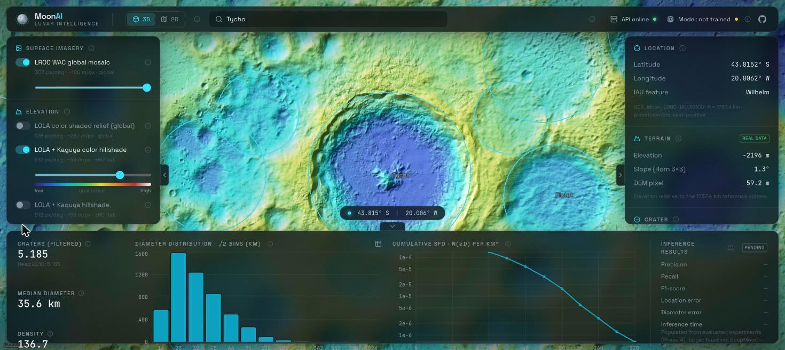
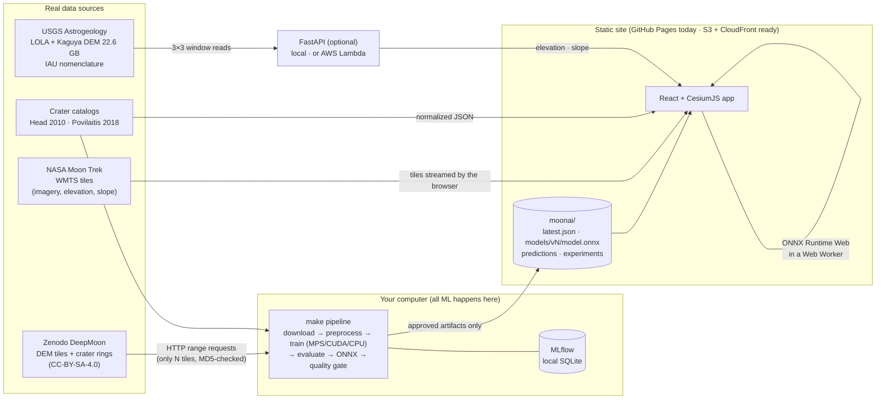
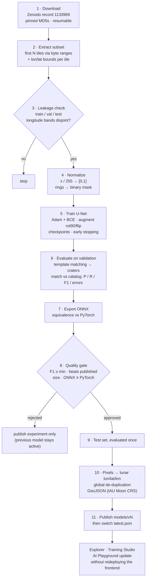

# MoonAI — Lunar Intelligence Platform

### 🌕 Live demo: **[jjullimayanne.github.io/moonIA](https://jjullimayanne.github.io/moonIA/)**

[](https://colab.research.google.com/github/jjullimayanne/moonIA/blob/main/notebooks/MoonAI_Colab_Training.ipynb) Train on a free GPU and watch it live in the Training Studio.

**An interactive, scientifically grounded lunar exploration platform: a "Google Earth for the Moon" built on real NASA/USGS data, with a deep-learning crater detector trained locally and running in your browser.**

Developed for the **Space Tech Bootcamp 2026 (FTL Brazil)**.



> **Status.** Lunar map, real data layers, catalogs, terrain readout, local training pipeline and the first trained model (**v1**, a reduced DeepMoon reproduction; see [Results](#results-model-v1-development-profile-trained-locally-on-apple-silicon)) are operational. All metrics shown come from real runs. Smoke runs are labelled as such, and nothing is simulated.

## What was built, in one minute

1. **A real lunar map.** CesiumJS draws the Moon on the IAU lunar sphere (R = 1737.4 km), *not* on Earth's WGS84 ellipsoid. It streams real NASA imagery, elevation and slope tiles, and overlays 24 520 catalogued craters and 9 087 official IAU names.
2. **Real terrain measurements.** Clicking a point reads elevation and slope from the 22.6 GB LOLA + Kaguya DEM with HTTP range requests (about 1 MB per point, never the whole file).
3. **A local deep-learning pipeline.** One command (`make pipeline`) downloads the DeepMoon dataset (only the tiles needed), checks it, trains a U-Net **on the Mac's GPU (MPS)**, evaluates it against the scientific catalogs, exports it to ONNX, runs a quality gate and publishes versioned artifacts.
4. **The first model (v1).** It was trained in about 14 minutes and found 2 214 craters in the held-out longitude bands. 70 % of its detections match a catalogued crater, and 657 are uncatalogued *candidates*.
5. **A lab you can explore.** The **Training Studio** replays the learning epoch by epoch, the **AI Playground** runs the model *in your browser* (ONNX Runtime Web in a Web Worker), and the **Experiments** page lists every run with its gate decision.
6. **Low-cost cloud design.** The site runs free on GitHub Pages. An AWS stack (S3 + CloudFront + Lambda) is ready in Terraform, designed for < US$ 5/month, and **not applied** until authorized.

## How it works






### How the model operates, in plain words

1. **Input: elevation, not photographs.** The network sees 256 × 256 grayscale tiles of the LOLA + Kaguya digital elevation model, where each pixel is terrain *height*. A photograph changes with the Sun angle, because shadows flip side. Height does not, so a crater is always a depression with a raised rim.
2. **Supervision: rings drawn from the catalogs.** Each training tile comes with a mask of the crater rims of the Head 2010 and Povilaitis 2018 catalogs. Both come from the DeepMoon dataset. The U-Net learns to draw those rings itself, outputting a rim probability for every pixel.
3. **From pixels to craters.** The probability map is thresholded at 0.1, and circles of radius 5–40 px are fitted by template matching. Each circle is converted to lunar longitude, latitude and diameter in km, and duplicates from overlapping tiles are merged.
4. **Runs once per model, not per visitor.** After an approved training run, the pipeline runs the model over the validation and test tiles and writes the craters to `moonai/predictions/vN/craters.geojson`. The map only reads that file. The one exception is the **AI Playground**, which runs the 3 MB `model.onnx` *inside the visitor's browser*, with no server involved.

### Where everything on the site comes from

| On screen | Source | Served by |
|---|---|---|
| Moon surface (imagery, elevation, slope) | NASA Moon Trek WMTS tiles | NASA servers, streamed directly by the browser |
| Blue / orange crater rims (Head 2010, Povilaitis 2018) | Real catalogs, normalized once by `backend/app/ingestion` | Static JSON in `frontend/public/data/catalogs/` |
| Crater names | IAU Gazetteer of Planetary Nomenclature (USGS) | Static JSON |
| Violet dashed rims and dots (AI detections) | Output of the trained model | Static GeoJSON in `frontend/public/moonai/predictions/` |
| Training Studio, Experiments, AI Discoveries | Pipeline artifacts (history, metrics, sample predictions) | Static JSON and PNG in `frontend/public/moonai/` |
| Elevation and slope of a clicked point | USGS LOLA + Kaguya DEM (22.6 GB), read by range requests | **FastAPI backend**: local only today, so the public site runs in "static mode" with these queries disabled |

The public site needs **no API and no server**. It is a static build on GitHub Pages, so it costs nothing.

### AWS: what is ready, and what turning it on adds

Everything is written in Terraform (`infrastructure/terraform/`) and validated: `terraform plan` shows 37 resources. **Nothing has been applied, and there is no AWS cost today.**

| Component | What it does | Why turn it on |
|---|---|---|
| **Lambda (arm64) + API Gateway HTTP API** | Runs the same FastAPI backend through Mangum. Throttled at 5 req/s (burst 10). | Makes click-to-measure **elevation and slope** work on the public site. This is the main gain. |
| **S3 (3 buckets) + CloudFront (OAC)** | Private buckets for the site, the model artifacts (`models/vN`, `latest.json`) and logs, behind a CDN with `/moonai/*` and `/api/*` routes. | One domain for the site and the API, plus publishing new models with `make pipeline PUBLISH=true` without a git commit. |
| **AWS Budgets + CloudWatch alarm** | E-mail alerts at US$ 1 / 3 / 5, and an alarm if storage exceeds 20 GB. | Cost safety: an alert, not a hard stop. |
| **GitHub OIDC role** | Lets the manual `deploy-aws.yml` workflow deploy without storing AWS keys. | Secure one-click deploys. |

Estimated cost (validated AWS prices, free tier ignored): **≈ US$ 0.37/month** for bootcamp-demo traffic and **≈ US$ 3.26/month** for an active project. With the always-free tier it is ≈ US$ 0. See [the cost estimate](docs/architecture/02-aws-cost-estimate.md).

Turning it on requires an explicit go-ahead, an e-mail address for the budget alerts, then `terraform apply` and the manual deploy workflow. There is no EC2, RDS, NAT or GPU, and training never runs on AWS.

---

## What it does today

| Feature | Data | Status |
|---|---|---|
| 3D globe and 2D map of the Moon on a **true lunar ellipsoid** (IAU sphere, R = 1737.4 km — not WGS84) | — | ✅ |
| Surface imagery: LROC WAC global mosaic (~100 m/px) | NASA Moon Trek | ✅ real |
| Elevation: LOLA color shaded relief (global), LOLA + Kaguya color hillshade / hillshade (59 m/px, ±60°) | NASA Moon Trek | ✅ real |
| Slope: LOLA + Kaguya (59 m/px) and LOLA global (poles) | NASA Moon Trek | ✅ real |
| Catalogued craters drawn as true geodesic rims: Head et al. 2010 (5 185, ≥ 20 km) and Povilaitis et al. 2018 (19 335, 5–20 km) | DeepMoon repo | ✅ real |
| IAU nomenclature labels + search by name or coordinates (`9.62, -20.08`, `9.62N 20.08W`, 0–360° E) | USGS Gazetteer | ✅ real |
| Click a point → exact **elevation** and **slope (Horn 3×3)** from the 22.6 GB LOLA–Kaguya DEM, read remotely by HTTP range requests | USGS Astrogeology | ✅ real (needs API) |
| Region of interest: spherical area, crater counts, density, **GeoJSON/CSV export** (lunar CRS declared) | — | ✅ |
| Science panel: √2-binned diameter histogram, cumulative size-frequency distribution, table view | — | ✅ |
| ⓘ hover explanations for every layer, panel and chart | — | ✅ |
| U-Net crater detection: model v1 trained locally, AI detections layer, Training Studio, AI Playground (browser inference), experiment registry | DeepMoon dataset | ✅ real (reduced reproduction) |

## Tech stack

**Frontend** (`frontend/`)
* **React 19 + TypeScript + Vite 8**
* **CesiumJS 1.147**: globe and 2D map; `Ellipsoid.MOON` + `GeographicTilingScheme` aligned with Trek's EPSG:104903 tiles. No Cesium ion token or commercial map APIs.
* **Tailwind CSS 4**: dark "mission control" design system (glass panels, cyan signal accents, Space Grotesk + JetBrains Mono)
* **Zustand** (UI/map state), **TanStack Query** (data fetching and caching), **Recharts** (science charts), **Lucide** (icons)
* **Vitest** unit tests for lunar geodesy and crater statistics

**Backend** (`backend/`)
* **Python 3.12 + FastAPI**, managed with **uv** (like the bootcamp setup)
* **Rasterio / GDAL `/vsicurl/`** for windowed DEM reads, **NumPy** for geodesy
* **Mangum** adapter so the same app runs on **AWS Lambda**
* Ingestion (pandas, pyshp, httpx) lives in a separate dependency group, outside the Lambda bundle
* **pytest** + **ruff**

**Infrastructure** (`infrastructure/`, `.github/`)
* **Terraform**: S3 + CloudFront (OAC) + Lambda (arm64) + API Gateway HTTP API + AWS Budgets + GitHub OIDC, **designed for < US$ 5/month** ([cost estimate](docs/architecture/02-aws-cost-estimate.md))
* **Docker / Docker Compose** for a one-command local stack
* **GitHub Actions**: CI (tests, typecheck, build, `terraform validate`), GitHub Pages preview, and a manual-only AWS deploy via OIDC

## Quick start

```bash
# 1. Backend (Python ≥ 3.12, uv)
cd backend
uv sync
uv run python -m app.ingestion.catalogs     # downloads + normalizes the real catalogs
uv run uvicorn app.api.main:app --port 8000

# 2. Frontend (Node ≥ 22)
cd ../frontend
npm install
npm run dev                                 # http://localhost:5173
```

Or with Docker: `docker compose up --build`, then open http://localhost:8080.

Tests:

```bash
cd backend && uv run pytest && uv run ruff check .
cd frontend && npm test && npm run typecheck
```


## Deep-learning pipeline (local training)

Training runs **on your own machine** (Apple Silicon MPS, NVIDIA CUDA or CPU, detected automatically) or **on a free Colab GPU** (below), never on AWS. AWS, once enabled, only stores published, approved artifacts.

```bash
make pipeline PROFILE=development      # download → preprocess → train → evaluate → ONNX → gate → publish to the local site
make pipeline PROFILE=production PUBLISH=true   # also uploads approved artifacts to S3 (explicit opt-in)
make resume | status | dry-run | dashboard | rollback VERSION=v1 | cost-check
```

**Training in the cloud for free:** [`notebooks/MoonAI_Colab_Training.ipynb`](notebooks/MoonAI_Colab_Training.ipynb) (step-by-step, in Portuguese) runs the same pipeline on a Colab GPU with fp16 mixed precision. Data and checkpoints go to Google Drive, so it resumes after disconnects. With `--sync git`, **every epoch is committed and pushed**, and the Training Studio shows the run live (~1–2 min GitHub Pages delay). It needs a fine-grained GitHub token (Contents: read/write on this repo only) stored in Colab Secrets.

| Profile | Train / val / test tiles | U-Net width | Epochs | Purpose |
|---|---|---|---|---|
| `smoke` | 64 / 32 / 0 | 16 | 3 | checks the whole pipeline in ~30 s; **never published as a model** |
| `development` | 6 000 / 400 / 400 | 32, rim-weighted loss (×5) | 12 | v2 experiment (v1 used 2 000 tiles, unweighted, 10 epochs) |
| `production` | 30 000 / 5 000 / 5 000 | 112 | 4 | DeepMoon reproduction (needs ~12 GB free disk) |

### The data as it comes (DeepMoon, Zenodo 10.5281/zenodo.1133969)

Measured on the downloaded tiles, not copied from the paper:

| | Raw format |
|---|---|
| **Input** `input_images` | `uint8`, 256 × 256 px, one channel. Each tile is an **orthographic re-projection** of a square crop of the LRO LOLA + SELENE Kaguya merged DEM (downsampled to 118 m/px), resized to 256 px. Pixel values are **relative elevation** in 0–255 (observed 0–177, mean 100.3, σ 42.4). About **14 % of pixels are 0**, which is padding at the tile edges left by the projection. |
| **Target** `target_masks` | `float32` {0, 1}: **1-pixel-wide rings** drawn at every catalogued crater rim (Head 2010 ≥ 20 km + Povilaitis 2018 5–20 km). Rims cover only **1.45 % of pixels**, a strong class imbalance. |
| **Georeferencing** | per tile: `longlat_bounds` (lon/lat extent), `pix_distortion_coefficient`, `cll_xy`. Tiles span 2–25° of latitude, so the scale ranges from **0.26 to 2.97 km/px** (median 0.67). |
| **Crater tables** `*_craters.hdf5` | per tile: lon, lat, diameter (km) and pixel x, y, diameter. A median of 11 craters per tile (0–189). |
| **Split** | by **longitude band**: train −180°…−60°, validation −60°…60°, test 60°…180°. The pipeline *verifies* the bands are disjoint and refuses to train otherwise. |

Only the tiles a profile needs are downloaded. The image arrays are stored contiguously in the HDF5 files, so the first *N* tiles are fetched with HTTP range requests (≈0.33 MB per tile instead of 9.9 GB per file), with every file MD5-checked against Zenodo.

### Data normalization and transformations (raw → model → map)

Every transformation applied to the data, in order. Nothing else is done to the data.

| # | Where | Raw data | Transformation | Why |
|---|---|---|---|---|
| 1 | Catalog ingestion | DeepMoon CSVs use classic-Mac `\r` line endings. IAU longitudes are 0–360° E. | Parse `\r`. **Normalize longitudes to [−180°, 180°)**. Validate ranges and declared coverage (Head: global, Povilaitis: ±60°). | One lunar convention everywhere: planetocentric latitude, east-positive longitude. |
| 2 | Terrain API | DEM `int16`, nodata −32768, `scale = 0.5`. | `elevation_m = DN × 0.5` relative to the 1737.4 km sphere. Nodata is rejected. Slope uses Horn 3×3 with `dx = 59.2 m · cos φ`. | Returns real metres and degrees, and corrects for east–west pixel shrinking with latitude. |
| 3 | Tile extraction | `input_images` `uint8` (0–177 observed, mean 100.3, σ 42.4; 14 % padding zeros). `target_masks` `float32` {0, 1}. | Images copied byte-exact. Masks **binarized (> 0.5) and stored as `uint8`**, which is lossless and 4× smaller. Lon/lat bounds, distortion and center are kept per tile. | Keeps every pixel tied to lunar coordinates. |
| 4 | Model input | `uint8` 0–255 | **`x / 255 → float32 ∈ [0, 1]`**. No mean/std standardization, no per-tile stretch. Padding stays 0. | The exact convention of the published DeepMoon data. Recorded in `latest.json → normalization` so the browser applies the identical rule. |
| 5 | Augmentation (train only) | — | Random **90° rotation** (k ∈ {0,1,2,3}) and **horizontal flip** (p = 0.5), applied identically to image and mask. | The only transforms that keep circles circular and avoid interpolating elevation. No shear, scaling, blur or contrast changes. |
| 6 | Loss | Rims are only **1.45 %** of pixels | `BCEWithLogitsLoss`, unweighted, as in DeepMoon. | Kept for comparability. A class-balanced loss is the next experiment. |
| 7 | Model output | logits | `sigmoid → probability that a pixel is a rim`. Binarized at **0.1** (DeepMoon `target_thresh`) before template matching and IoU. | |
| 8 | Pixels → craters | binary rim map | Ring template matching r = 5–40 px, correlation > 0.5, duplicate merge Δpos²/r² < 1.8 and Δr/r < 1. | DeepMoon post-processing, unchanged. |
| 9 | Pixels → Moon | (x, y, r) px | DeepMoon's inverse orthographic transform → **lon°, lat°, diameter km** on R = 1737.4 km (checked against the catalog: median error 0.01°). Overlapping tiles are **globally de-duplicated**: 3 336 → 2 214. | Map-ready GeoJSON, declared in the lunar CRS (never WGS84). |

### Network architecture: U-Net (after DeepMoon, Silburt et al. 2019)

```
input 1×256×256 (DEM, [0,1])
 ├─ enc1: [conv3×3 → ReLU] ×2 → F      ──────────────────────────────┐ skip
 │  maxpool 2×2 → 128²                                                │
 ├─ enc2: [conv3×3 → ReLU] ×2 → 2F     ────────────────────┐ skip      │
 │  maxpool → 64²                                          │           │
 ├─ enc3: [conv3×3 → ReLU] ×2 → 4F     ─────────┐ skip      │           │
 │  maxpool → 32²                               │           │           │
 ├─ bottleneck: [conv3×3 → ReLU] ×2 → 4F         │           │           │
 ├─ up ×2 (nearest) ⊕ enc3 → dropout → [conv → ReLU]×2 → 2F  │           │
 ├─ up ×2 ⊕ enc2 → dropout → [conv → ReLU]×2 → F             │           │
 ├─ up ×2 ⊕ enc1 → dropout → [conv → ReLU]×2 → F                         │
 └─ conv1×1 → 1×256×256 logits → sigmoid = probability that a pixel is a crater rim
```

| | DeepMoon (paper/code) | MoonAI |
|---|---|---|
| Filters F | 112 | 112 (production) · 32 (development) · 16 (smoke) |
| Parameters | — | ≈10.3 M at F = 112 · ≈0.84 M at F = 32 |
| Dropout | 0.15 | 0.15 (`Dropout2d`, decoder) |
| Init | He-normal | He-normal (Kaiming) |
| Loss | binary cross-entropy on sigmoid | `BCEWithLogitsLoss` (same objective, numerically stabler) |
| Optimizer | Adam, lr 1e-4, L2 1e-6 | Adam, lr 1e-4, weight decay 1e-6, ReduceLROnPlateau ×0.5 |
| Batch / epochs | 8 / 4 | automatic from free memory (halved on OOM) / per profile, early stopping |
| Framework | Keras | PyTorch 2.15 (MPS / CUDA / CPU) → ONNX opset 17 |

### From pixels to craters (evaluation)

1. Threshold the predicted probability at **0.1** and run **ring template matching** for radii 5–40 px, keeping correlation > **0.5**. Near-duplicates are merged with DeepMoon's criteria: Δpos²/r² < 1.8 and Δr/r < 1.0.
2. Match detections **one-to-one** to the catalog craters of each tile under the same criteria, which gives precision, recall, F1, and location and diameter errors. The pixel IoU of the rim map is reported too.
3. Convert pixels to lunar **lon/lat/diameter** with DeepMoon's inverse orthographic transform (verified against the catalog: median error 0.01° lon, 0.002° lat, 0 % diameter).
4. **Quality gate** (validation set only): ONNX ≡ PyTorch (max |Δp| ≤ 1e-3), size limit, minimum F1, and it must beat the currently published model. The **test set** is evaluated once, only for an approved model.

### Results: model v1 (development profile, trained locally on Apple Silicon)

Run `development-20261124-115919-0b5ebde`: 2 000 training / 400 validation / 400 test tiles, U-Net F = 32 (0.84 M parameters), 10 epochs × ~82 s on MPS (batch 4), about 14 min of training. Passed the quality gate and published as **v1**.

| Metric | Validation (−60°…60° lon) | **Test (60°…180° lon, evaluated once)** |
|---|---|---|
| Precision (vs. catalog, lower bound) | 0.669 | **0.705** |
| Recall | 0.244 | **0.156** |
| F1 | 0.358 | **0.256** |
| Median location error (Δpos / r) | 0.117 | 0.116 |
| Median diameter error (Δr / r) | 0.063 | 0.055 |
| Rim-pixel IoU (threshold 0.1) | 0.114 | 0.129 |
| Inference | 8.4 ms/tile (MPS) · 48 ms/tile (ONNX CPU) · ~320 ms/tile (browser, wasm 1 thread) | |

**Recall vs. crater size** (validation, radius in pixels): 5–7 px **0.30** · 7–10 px 0.29 · 10–14 px 0.22 · 14–20 px 0.13 · 20–28 px 0.09 · 28–40 px **0.05**.
**F1 vs. resolution** (km/px): < 0.25: 0.48 · 0.25–0.5: 0.47 · 0.5–1: **0.55** · 1–2: 0.36 · 2–4: **0.20**.

Interpretation, honestly stated:
* This is a **reduced reproduction**. It used 7 % of DeepMoon's training tiles, a 3.5× narrower network, and 10 short epochs, so it is far from DeepMoon's 92 % recall. Detections are **precise** (≈70 % match a catalogued crater, and the rest may be real uncatalogued craters) but **recall is low**, especially for large craters. With 3 levels of pooling, the receptive field is smaller than big rims.
* Test recall is lower than validation recall. The test band (60°–180° E) is dominated by far-side highlands, with more numerous and overlapping craters (8 670 catalogued vs 3 883 in the same number of validation tiles). A plausible explanation, **not yet tested**, is a terrain shift. The stratified terrain analysis (mare vs highland) is the planned check.
* **Next experiment:** see *Why v1 underperforms, and what v2 changes* below.
* ONNX matches PyTorch to 2·10⁻⁶. The int8-quantized model is 0.83 MB (vs 3.21 MB) but shifts probabilities by up to 0.098, so the **fp32 model is the one published**.
* Global deduplication merged 3 336 tile-level detections into **2 214 unique craters**. **657** of them match no catalogued crater and are shown as *candidates* in the Explorer ("Only uncatalogued") and on the **AI Discoveries** page.
* **Independent check against the IAU gazetteer:** **321 of the 657 candidates (48.9 %)** coincide with an officially named IAU crater of similar size (within max(1.5 km, D/2), diameters within ×2). Shifting the same candidates 30–80 km at random gives **2.3 %** (5 trials), so the result is **~21× above chance**. About half of the "new" detections are therefore real craters, mostly smaller than 5 km, that the training catalogs (Head ≥ 20 km, Povilaitis 5–20 km) omit. The model found them without ever being taught them. The other half remain **unverified candidates, not confirmed discoveries**. Reproduce with `python3 scripts/iau_crosscheck.py`.
* *Correction log:* the first computation of pixel IoU used a 0.5 threshold, above every probability this model outputs (max 0.52), and reported 0.100. It was recomputed at DeepMoon's 0.1 binarization threshold, excluding crater-free tiles, from the saved predictions.

**Post-processing ceiling.** Run on the *ground-truth* rings themselves, the matcher reaches precision 0.88 / recall 0.86 when rims are ~3 px wide (typical CNN output), but only recall 0.42 on the perfect 1-px rings. A 2-px template correlates weakly with 1-px lines. This is a property of DeepMoon's post-processing and is kept unchanged for comparability.

### Why v1 underperforms, and what v2 changes

| # | Limitation of v1 (evidence) | v2 adjustment |
|---|---|---|
| 1 | **Too little data.** 2 000 training tiles is 7 % of DeepMoon's 30 000. The network saw few examples of each crater size and terrain. | **3× more data:** 6 000 training tiles. Validation and test tiles are unchanged, so v1 and v2 are directly comparable. |
| 2 | **Class imbalance.** Only 1.45 % of pixels are rim. Unweighted BCE rewards predicting "no rim", so the outputs are timid (max probability 0.52) and faint rims fall below the 0.1 threshold. This is the main cause of the low recall. | **Rim-weighted loss:** `pos_weight = 5`, so a missed rim pixel costs 5× more. |
| 3 | **Short training.** 10 epochs × ~14 min on a laptop, and the validation loss was still falling. | **12 epochs** with early stopping (patience 4), on a Colab T4 GPU with fp16 AMP. |
| 4 | **Small network.** F = 32 (0.84 M parameters) and 3 pooling levels. The receptive field is smaller than large rims, so recall for 28–40 px radii is 0.05. | Not changed in v2, to isolate the effect of data and loss. The **production** profile (F = 112, 10.3 M parameters, 30 000 tiles) addresses it. |
| 5 | **Post-processing ceiling.** The ring matcher finds only 42 % of perfect 1-px rings (see above). | Kept unchanged, for comparability with DeepMoon. |

**First v2 attempt (rejected by the quality gate).** The first v2 run on Colab gave validation **P 0.307 · R 0.050 · F1 0.086**, far below v1. The gate blocked it, so the site kept serving v1.

Probable cause: `pos_weight = w` multiplies the odds the network learns by *w*. Every probability was therefore inflated, while the 0.1 rim threshold and the ring matcher are calibrated for unweighted BCE. Thresholded masks became thick blobs instead of thin rings, which ruined both recall and precision.

Fix (commit `560f4e7`): the logits are shifted by −log *w* before thresholding. This applies to evaluation and to the per-epoch previews. The same shift is folded into the head bias of the saved model, so the ONNX file and the browser receive calibrated probabilities. A unit test checks the odds ratio. v1 (*w* = 1) is unaffected.

The cause is an inference from the code and the metrics. That run's per-epoch history was not synced, so the re-run is the confirmation. If the calibrated v2 still does not beat v1, the plan is to drop the weighting and keep only the larger dataset.

## Scientific foundations

**Research question.** *How well can deep-learning models identify lunar craters from topographic data, and how does that ability vary with crater size, spatial resolution and terrain characteristics?*

* **Reference methodology: DeepMoon** (Silburt et al. 2019, *Icarus*). A U-Net segments crater rims in DEM crops, then template matching extracts (lon, lat, radius). We reproduce it first, with parameters verified from the original source code, before proposing improvements.
* **Improvement direction: Yang et al. 2020** (*Nature Communications*). Transfer learning with Chang'E DOM + DEM data identified 109,956 new craters.
* **No spatial leakage.** Train/validation/test sets come from disjoint longitude bands, asserted by the pipeline. The test set is never used for model selection.
* **Responsible use.** Regions are only flagged as *areas of interest for further investigation*. Slope and crater counts at these resolutions don't establish landing safety.

Docs:
* [Data sources (verified URLs, licenses, sizes, formats)](docs/scientific/01-data-sources.md)
* [Lunar coordinate reference system](docs/scientific/02-lunar-crs.md)
* [Methodology & experiment design](docs/scientific/03-methodology.md)
* [Architecture & decisions](docs/architecture/01-architecture.md)
* [AWS cost estimate (validated prices)](docs/architecture/02-aws-cost-estimate.md)
* [Bibliography](docs/references/bibliography.md)

## Data & licenses

| Data | Provider | License |
|---|---|---|
| LROC WAC, LOLA, LOLA–Kaguya tiles | NASA Moon Trek (LRO / JAXA SELENE) | NASA open data |
| LOLA + Kaguya merged DEM (Barker et al. 2016) | USGS Astrogeology | Public domain |
| DeepMoon dataset | Zenodo 10.5281/zenodo.1133969 | CC-BY-SA-4.0 |
| Head 2010 / Povilaitis 2018 catalogs | via DeepMoon repo | MIT (repo); cite original papers |
| IAU lunar nomenclature | USGS Gazetteer of Planetary Nomenclature | Public domain |

## Roadmap

1. ✅ Scientific validation and real-data access
2. ✅ Frontend with lunar map and real geospatial layers
3. ⏳ Data-processing pipeline (DeepMoon HDF5 streaming, DEM tiling)
4. 🟡 U-Net training and scientific evaluation: v1 (development) done; production reproduction pending
5. ✅ Inference integration: ONNX Runtime Web in a Web Worker, versioned models via `latest.json`
6. ⏳ Topographic analysis and stratified scientific results
7. ⏳ Documentation and presentation

## Repository layout

```
moonai/
  frontend/          React + CesiumJS app
  backend/           FastAPI app (lunar CRS, catalogs, terrain, API, Lambda handler)
  ml/                deep-learning pipeline (in progress)
  data/catalogs/     normalized real crater catalogs (CSV, small, versioned)
  infrastructure/    Terraform (AWS, ≤ US$ 5/month)
  docs/              scientific & architecture documentation
  .github/workflows/ CI, Pages preview, manual AWS deploy
```

---

Imagery and topography courtesy of NASA/GSFC/Arizona State University (LROC), NASA/GSFC (LOLA), JAXA/SELENE (Kaguya TC), NASA Moon Trek and USGS Astrogeology Science Center.
